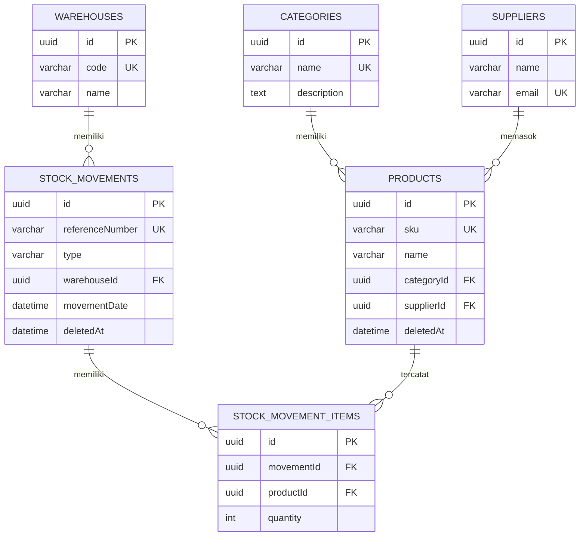

# API Specification — Inventory Management API

## 1. Informasi umum

- Base URL development: `http://localhost:3000` (mengikuti environment variable `PORT`; contoh `.env` memakai `3001`)
- Format request dan response: JSON
- ID: UUID
- Nama field JSON: camelCase
- Waktu: ISO 8601
- Database: PostgreSQL dengan TypeORM
- ValidationPipe aktif dengan `whitelist`, `forbidNonWhitelisted`, `transform`, dan implicit conversion. Field yang tidak dikenal atau body tidak valid menghasilkan `400`.
- Semua response sukses dibungkus oleh `TransformInterceptor`:

```json
{
  "statusCode": 200,
  "data": {}
}
```

- Semua error memakai format:

```json
{
  "statusCode": 404,
  "message": "Produk dengan id ... tidak ditemukan",
  "error": "Not Found"
}
```

- Produk dan transaksi stok memakai soft delete (`deletedAt`). Kategori, pemasok, gudang, dan item transaksi dihapus permanen.
- Tidak ada autentikasi dan pagination pada scope UTS ini. Endpoint list mengembalikan array langsung di dalam `data`.

## 2. Ringkasan endpoint

| Method | Path | Keterangan | Sukses |
|---|---|---|---|
| GET | `/` | Pesan sambutan API | 200 |
| GET | `/categories` | Daftar kategori | 200 |
| POST | `/categories` | Buat kategori | 201 |
| GET | `/categories/:id` | Detail kategori | 200 |
| PATCH | `/categories/:id` | Ubah kategori | 200 |
| DELETE | `/categories/:id` | Hapus kategori | 200 |
| GET | `/suppliers` | Daftar pemasok | 200 |
| POST | `/suppliers` | Buat pemasok | 201 |
| GET | `/suppliers/:id` | Detail pemasok | 200 |
| PATCH | `/suppliers/:id` | Ubah pemasok | 200 |
| DELETE | `/suppliers/:id` | Hapus pemasok | 200 |
| GET | `/warehouses` | Daftar gudang | 200 |
| POST | `/warehouses` | Buat gudang | 201 |
| GET | `/warehouses/:id` | Detail gudang | 200 |
| PATCH | `/warehouses/:id` | Ubah gudang | 200 |
| DELETE | `/warehouses/:id` | Hapus gudang | 200 |
| GET | `/products` | Daftar produk beserta kategori dan pemasok | 200 |
| POST | `/products` | Buat produk | 201 |
| GET | `/products/:id` | Detail produk | 200 |
| GET | `/products/:id/stock` | Stok produk berdasarkan transaksi aktif | 200 |
| PATCH | `/products/:id` | Ubah produk | 200 |
| DELETE | `/products/:id` | Soft delete produk | 200 |
| GET | `/stock-movements` | Daftar transaksi stok beserta item | 200 |
| POST | `/stock-movements` | Buat transaksi stok beserta item | 201 |
| GET | `/stock-movements/:id` | Detail transaksi stok beserta item | 200 |
| PATCH | `/stock-movements/:id` | Ubah catatan/tanggal transaksi | 200 |
| DELETE | `/stock-movements/:id` | Void transaksi stok (soft delete) | 200 |
| GET | `/stock-movement-items?movementId=UUID` | Daftar item transaksi, opsional filter transaksi | 200 |
| POST | `/stock-movement-items` | Tambah item ke transaksi | 201 |
| GET | `/stock-movement-items/:id` | Detail item transaksi | 200 |
| PATCH | `/stock-movement-items/:id` | Ubah produk/kuantitas item | 200 |
| DELETE | `/stock-movement-items/:id` | Hapus item transaksi | 200 |

## 3. Parameter

- Semua path parameter `:id` wajib berupa UUID. Format tidak valid menghasilkan `400`.
- Query parameter `movementId` pada `GET /stock-movement-items` opsional dan harus UUID.
- `GET /stock-movement-items` tanpa `movementId` mengembalikan seluruh item.
- Endpoint list tidak memakai pagination, search, atau sorting query.

## 4. Request body dan aturan validasi

### 4.1 Kategori

`POST /categories`

```json
{
  "name": "Elektronik",
  "description": "Perangkat elektronik"
}
```

- `name`: wajib, string, maksimal 100 karakter, unik.
- `description`: opsional, string.
- `PATCH /categories/:id` menerima sebagian field yang sama.

### 4.2 Pemasok

`POST /suppliers`

```json
{
  "name": "PT Sumber Makmur",
  "email": "sales@example.com",
  "phone": "0215551234",
  "address": "Jakarta"
}
```

- `name`: wajib, string, maksimal 150 karakter.
- `email`: opsional, email valid, maksimal 150 karakter, unik.
- `phone`: opsional, string, maksimal 20 karakter.
- `address`: opsional, string.
- `PATCH /suppliers/:id` menerima sebagian field yang sama.

### 4.3 Gudang

`POST /warehouses`

```json
{
  "code": "WH-JKT-01",
  "name": "Gudang Jakarta",
  "address": "Jl. Industri No. 10",
  "city": "Jakarta"
}
```

- `code`: wajib, string, maksimal 20 karakter, unik.
- `name`: wajib, string, maksimal 150 karakter.
- `address`: opsional, string.
- `city`: opsional, string, maksimal 100 karakter.
- `PATCH /warehouses/:id` menerima sebagian field yang sama.

### 4.4 Produk

`POST /products`

```json
{
  "sku": "ELK-0001",
  "name": "Keyboard",
  "description": "Keyboard mekanik",
  "unit": "pcs",
  "price": 250000,
  "minStock": 5,
  "categoryId": "UUID_CATEGORY",
  "supplierId": "UUID_SUPPLIER"
}
```

- `sku`: wajib, string, maksimal 50 karakter, unik.
- `name`: wajib, string, maksimal 255 karakter.
- `description`: opsional, string.
- `unit`: wajib, string, maksimal 20 karakter.
- `price`: opsional, number minimal 0, maksimal 2 angka desimal. Default database 0.
- `minStock`: opsional, integer minimal 0. Default database 0.
- `categoryId`: opsional, UUID. Jika diisi, kategori harus ada.
- `supplierId`: opsional, UUID. Jika diisi, pemasok harus ada.
- `PATCH /products/:id` menerima sebagian field yang sama.

### 4.5 Transaksi stok

`POST /stock-movements`

```json
{
  "type": "IN",
  "warehouseId": "UUID_WAREHOUSE",
  "movementDate": "2026-11-06T10:00:00.000Z",
  "notes": "Stok masuk",
  "items": [
    {
      "productId": "UUID_PRODUCT",
      "quantity": 20
    }
  ]
}
```

- `type`: wajib, enum `IN` atau `OUT`.
- `warehouseId`: wajib, UUID dan gudang harus ada.
- `movementDate`: opsional, ISO 8601. Default waktu server.
- `notes`: opsional, string.
- `items`: wajib, array minimal 1 item.
- `items[].productId`: wajib, UUID dan produk harus ada.
- `items[].quantity`: wajib, integer minimal 1.
- Satu produk tidak boleh muncul lebih dari sekali dalam transaksi yang sama.
- `referenceNumber` dibuat server dengan pola `SM-YYYYMMDD-XXXXXXXX` dan unik.
- Untuk `type = OUT`, stok produk di gudang tujuan harus mencukupi.

`PATCH /stock-movements/:id`

```json
{
  "notes": "Catatan diperbarui",
  "movementDate": "2026-11-06T11:00:00.000Z"
}
```

Hanya `notes` dan/atau `movementDate` yang diterima. `type`, `warehouseId`, dan `items` ditolak oleh validasi global.

### 4.6 Item transaksi stok

`POST /stock-movement-items`

```json
{
  "movementId": "UUID_MOVEMENT",
  "productId": "UUID_PRODUCT",
  "quantity": 5
}
```

- `movementId`: wajib, UUID dan transaksi harus ada serta belum di-void.
- `productId`: wajib, UUID dan produk harus ada.
- `quantity`: wajib, integer minimal 1.
- Produk yang sama tidak boleh ditambahkan dua kali pada transaksi yang sama.
- Untuk transaksi `OUT`, stok harus mencukupi.

`PATCH /stock-movement-items/:id`

```json
{
  "productId": "UUID_PRODUCT_LAIN",
  "quantity": 8
}
```

- Kedua field opsional, tetapi minimal salah satu diisi.
- Untuk transaksi `OUT`, perubahan kuantitas/produk tetap divalidasi terhadap stok tersedia.

## 5. Response body

Semua contoh di bawah adalah isi `data`. Response asli tetap dibungkus `{ "statusCode": ..., "data": ... }`.

### 5.1 Kategori

```json
{
  "id": "UUID",
  "name": "Elektronik",
  "description": "Perangkat elektronik",
  "createdAt": "2026-11-12T10:00:00.000Z",
  "updatedAt": "2026-11-12T10:00:00.000Z"
}
```

`GET /categories` mengembalikan array kategori. `POST` mengembalikan objek kategori dengan status `201`.

### 5.2 Pemasok

```json
{
  "id": "UUID",
  "name": "PT Sumber Makmur",
  "email": "sales@example.com",
  "phone": "0215551234",
  "address": "Jakarta",
  "createdAt": "2026-11-12T10:00:00.000Z",
  "updatedAt": "2026-11-12T10:00:00.000Z"
}
```

### 5.3 Gudang

```json
{
  "id": "UUID",
  "code": "WH-JKT-01",
  "name": "Gudang Jakarta",
  "address": "Jl. Industri No. 10",
  "city": "Jakarta",
  "createdAt": "2026-11-12T10:00:00.000Z",
  "updatedAt": "2026-11-12T10:00:00.000Z"
}
```

### 5.4 Produk

```json
{
  "id": "UUID",
  "sku": "ELK-0001",
  "name": "Keyboard",
  "description": "Keyboard mekanik",
  "unit": "pcs",
  "price": 250000,
  "minStock": 5,
  "categoryId": "UUID_CATEGORY",
  "supplierId": "UUID_SUPPLIER",
  "deletedAt": null,
  "createdAt": "2026-11-12T10:00:00.000Z",
  "updatedAt": "2026-11-12T10:00:00.000Z",
  "category": {
    "id": "UUID_CATEGORY",
    "name": "Elektronik"
  },
  "supplier": {
    "id": "UUID_SUPPLIER",
    "name": "PT Sumber Makmur"
  }
}
```

### 5.5 Transaksi stok

```json
{
  "id": "UUID",
  "referenceNumber": "SM-20261112-AB12CD34",
  "type": "IN",
  "warehouseId": "UUID_WAREHOUSE",
  "movementDate": "2026-11-12T10:00:00.000Z",
  "notes": "Stok masuk",
  "deletedAt": null,
  "createdAt": "2026-11-12T10:00:00.000Z",
  "updatedAt": "2026-11-12T10:00:00.000Z",
  "warehouse": {
    "id": "UUID_WAREHOUSE",
    "code": "WH-JKT-01",
    "name": "Gudang Jakarta"
  },
  "items": [
    {
      "id": "UUID_ITEM",
      "movementId": "UUID",
      "productId": "UUID_PRODUCT",
      "quantity": 20,
      "product": {
        "id": "UUID_PRODUCT",
        "sku": "ELK-0001",
        "name": "Keyboard"
      }
    }
  ]
}
```

### 5.6 Item transaksi stok

```json
{
  "id": "UUID_ITEM",
  "movementId": "UUID",
  "productId": "UUID_PRODUCT",
  "quantity": 20,
  "createdAt": "2026-11-12T10:00:00.000Z",
  "updatedAt": "2026-11-12T10:00:00.000Z",
  "movement": {
    "id": "UUID",
    "referenceNumber": "SM-20261112-AB12CD34",
    "type": "IN",
    "warehouse": {
      "id": "UUID_WAREHOUSE",
      "code": "WH-JKT-01",
      "name": "Gudang Jakarta"
    }
  },
  "product": {
    "id": "UUID_PRODUCT",
    "sku": "ELK-0001",
    "name": "Keyboard"
  }
}
```

### 5.7 Stok produk

`GET /products/:id/stock`

```json
{
  "productId": "UUID_PRODUCT",
  "sku": "ELK-0001",
  "name": "Keyboard",
  "unit": "pcs",
  "minStock": 5,
  "totalStock": 20,
  "isLowStock": false,
  "warehouses": [
    {
      "warehouseId": "UUID_WAREHOUSE",
      "code": "WH-JKT-01",
      "name": "Gudang Jakarta",
      "totalIn": 20,
      "totalOut": 0,
      "stock": 20
    }
  ]
}
```

- `warehouses` hanya berisi gudang yang memiliki transaksi aktif untuk produk tersebut.
- `isLowStock` bernilai `true` jika `totalStock <= minStock`.

### 5.8 Response delete

```json
{
  "message": "Produk berhasil dihapus",
  "id": "UUID"
}
```

Beberapa resource mengembalikan bentuk yang sedikit berbeda:

- Kategori: `{ "message": "Kategori berhasil dihapus" }`
- Pemasok: `{ "message": "Pemasok ... berhasil dihapus", "deletedId": "UUID" }`
- Gudang: `{ "message": "Gudang berhasil dihapus" }`
- Transaksi stok: `{ "message": "Transaksi stok berhasil di-void", "id": "UUID" }`
- Item transaksi: `{ "message": "Item transaksi stok berhasil dihapus", "id": "UUID" }`

## 6. Perhitungan stok dan aturan bisnis

Rumus stok:

```text
stok = total quantity transaksi IN - total quantity transaksi OUT
```

Aturan:

1. Hanya transaksi yang belum di-void (`deletedAt IS NULL`) yang dihitung.
2. Stok dihitung per produk dan per gudang, lalu dijumlahkan untuk `totalStock`.
3. Transaksi `OUT` ditolak dengan `400` jika stok produk di gudang tujuan tidak mencukupi.
4. Validasi stok juga berlaku saat menambah atau mengubah item pada transaksi `OUT`.
5. Menghapus transaksi berarti void (soft delete), sehingga stok otomatis kembali karena transaksi tidak lagi dihitung.
6. Menghapus item transaksi `OUT` juga mengembalikan stok produk.
7. Satu produk hanya boleh muncul satu kali dalam satu transaksi.
8. Produk yang dihapus memakai soft delete; data transaksi lama tetap tersimpan.

## 7. Status dan error

| Status | Kondisi |
|---|---|
| 200 | GET, PATCH, DELETE berhasil |
| 201 | POST berhasil |
| 400 | UUID tidak valid, validasi DTO gagal, field tambahan dikirim, produk duplikat dalam transaksi, atau stok tidak mencukupi |
| 404 | ID data tidak ditemukan |
| 409 | Pelanggaran unique key, foreign key, atau produk sudah ada pada transaksi |
| 500 | Error database lain yang belum dipetakan |

Contoh error validasi:

```json
{
  "statusCode": 400,
  "message": [
    "sku should not be empty",
    "price must not be less than 0"
  ],
  "error": "Bad Request"
}
```

Contoh error tidak ditemukan:

```json
{
  "statusCode": 404,
  "message": "Transaksi stok dengan id UUID tidak ditemukan",
  "error": "Not Found"
}
```

Contoh error konflik:

```json
{
  "statusCode": 409,
  "message": "Data dengan nilai unik tersebut sudah ada",
  "error": "Conflict"
}
```

## 8. Struktur tabel dan relasi

Semua tabel utama memiliki `id` UUID, `createdAt`, dan `updatedAt`. Produk dan transaksi stok memiliki `deletedAt`.

| Tabel | Kolom utama |
|---|---|
| `categories` | `name` varchar(100) unik; `description` text nullable |
| `suppliers` | `name` varchar(150); `email` varchar(150) nullable dan unik; `phone` varchar(20) nullable; `address` text nullable |
| `warehouses` | `code` varchar(20) unik; `name` varchar(150); `address` text nullable; `city` varchar(100) nullable |
| `products` | `sku` varchar(50) unik; `name` varchar(255); `description` text nullable; `unit` varchar(20); `price` decimal(12,2); `minStock` int; `categoryId` UUID nullable; `supplierId` UUID nullable; `deletedAt` nullable |
| `stock_movements` | `referenceNumber` varchar(50) unik; `type` varchar(10) IN/OUT; `warehouseId` UUID; `movementDate` timestamptz; `notes` text nullable; `deletedAt` nullable |
| `stock_movement_items` | `movementId` UUID; `productId` UUID; `quantity` int minimal 1; pasangan `movementId` dan `productId` unik |

Relasi:

- Satu kategori memiliki banyak produk; satu produk memiliki satu kategori.
- Satu pemasok memasok banyak produk; satu produk memiliki satu pemasok.
- Satu gudang memiliki banyak transaksi pergerakan stok.
- Satu transaksi memiliki banyak item.
- Satu produk dapat muncul di banyak item transaksi.
- Foreign key `products.categoryId` dan `products.supplierId` memakai `RESTRICT`.
- Foreign key `stock_movements.warehouseId` memakai `RESTRICT`.
- Foreign key `stock_movement_items.movementId` memakai `CASCADE`.
- Foreign key `stock_movement_items.productId` memakai `RESTRICT`.

### ERD ringkas



## 9. Catatan implementasi

- Setiap resource memiliki `Module`, `Controller`, `Service`, entity, dan DTO sendiri.
- Validasi request memakai `class-validator` dan `class-transformer`.
- Response sukses diproses `TransformInterceptor`.
- Error database PostgreSQL dipetakan `DatabaseExceptionFilter` menjadi `400` atau `409`.
- Schema database disinkronkan TypeORM saat `NODE_ENV=development`. Untuk production, matikan `synchronize` dan gunakan migration.
